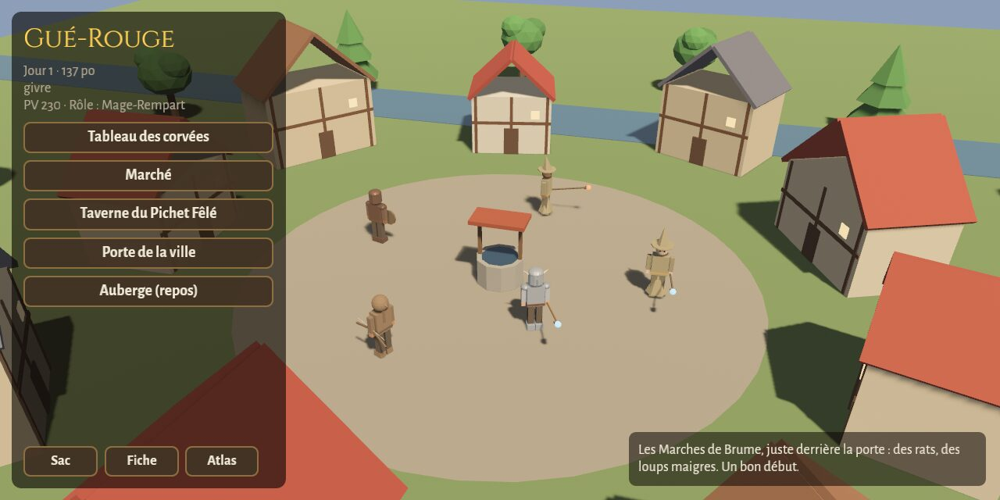
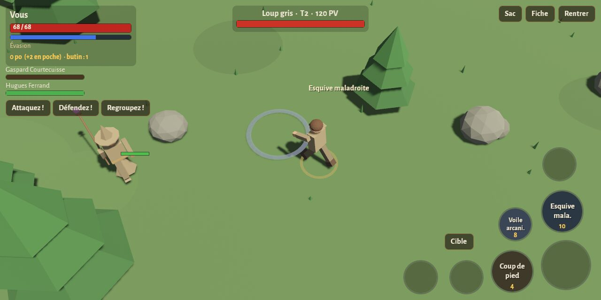
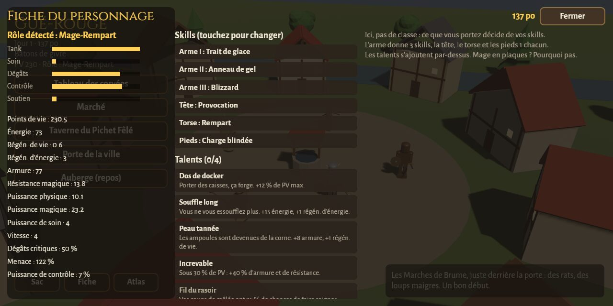
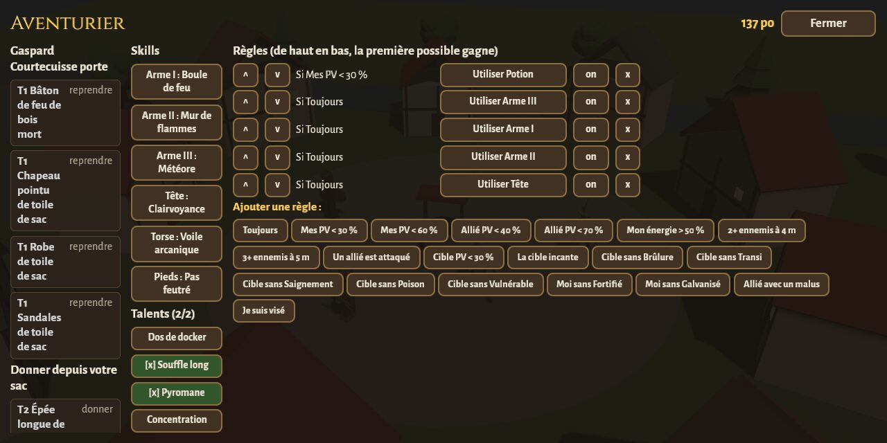

# Errance

RPG solo pour téléphone Android (à l'horizontale), écrit en Rust avec Bevy.

Vous arrivez à Gué-Rouge en haillons, sans un sou. Pas de classe à choisir : **ce que vous portez décide de ce que vous savez faire**. Corvées, rats, loups, compagnies de mercenaires qui vous prennent comme porteur… puis, à force de pratique, vous devenez quelqu'un.






## Installer sur le téléphone
1. Ouvrir la page **Releases** du dépôt → `apk-latest` → télécharger `Errance.apk` (construit automatiquement à chaque push).
2. Autoriser l'installation depuis le navigateur si Android le demande.
3. Chaque nouvel APK s'installe par-dessus l'ancien, la sauvegarde est gardée.

## Jouer sur PC (pour tester)
```
cargo run -p errance_game
```
ZQSD/WASD pour bouger (ou cliquer-glisser à gauche, comme le joystick), 1-7 pour les skills, Tab pour changer de cible, clic droit pour cibler, molette pour zoomer.

## Pour les curieux
- `crates/errance_core` : toutes les règles (testées), sans moteur.
- `crates/errance_core/content/*.ron` : le contenu, modifiable à la main (skills, objets, monstres, zones…). Lancer `cargo test -p errance_core` après une modification.
- `crates/errance_sim` : simulateur d'équilibrage (`cargo run -p errance_sim --release`).
- `crates/errance_game` : le jeu (3D low-poly fabriquée par le code, sons et musique générés).
